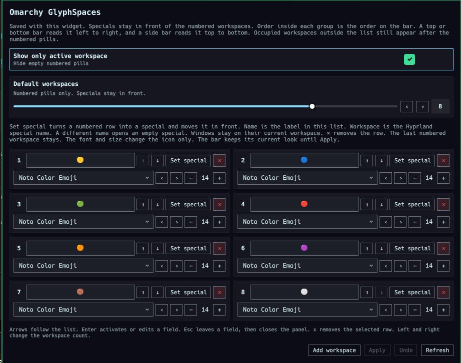

# Omarchy GlyphSpaces

Colored workspace pills for the [Omarchy](https://omarchy.org/) bar. Choose how many numbered workspaces to keep, put one special in front, and give each pill a symbol, an emoji, and a label. Set the font, size, bold, italic, and color per workspace, hide inactive pills, turn the numbers on or off, follow the Omarchy theme, and import or export the setup.

The plugin id is `crome.workspaces`. The focused workspace has a square accent outline. Install and remove it with the Omarchy plugin commands.

One special stays in front of the numbered workspaces. Order inside each group is the order on the bar: left to right on a top or bottom bar, top to bottom on a side bar. On a side bar the label reads downward. An occupied workspace that is not in the list still appears after the numbered pills. A pill can be a colored dot, a symbol with a label such as Coding, or the label alone.

Left-click focuses a workspace. Scrolling walks specials in order, then the numbered workspaces. Scrolling forward from the last special closes it. Scrolling back from the lowest numbered workspace opens the last special. Right-click opens settings.

Empty numbered pills stay hidden while **Show only active workspace** is on. The focused workspace still shows. A fresh install starts with that on, and with eight colored dots. A saved row from an earlier install is used when one is already on disk.

## Preview



## Install

```bash
omarchy plugin add https://github.com/crome1394/omarchy-glyphspaces.git
omarchy plugin enable crome.workspaces --section left
```

The stock workspace widget and this one both draw workspaces. Turn the stock one off if you only want these dots:

```bash
omarchy plugin disable omarchy.workspaces
```

Move it with `omarchy bar move crome.workspaces --section <left|center|right>`.

Disable it from the Omarchy menu under Setup, Plugins, or with `omarchy plugin disable crome.workspaces`. Remove it with `omarchy plugin remove crome.workspaces`. While the plugin is enabled, the saved row lives on its entry in `~/.config/omarchy/shell.json`. Disabling drops that entry. A copy stays at `~/.local/state/omarchy/crome.workspaces.json`, and enabling the plugin writes the copy back onto the bar. Removing the plugin deletes its files. That copy stays in the state directory, so a later install brings the same row back.

## Settings

Right-click the widget, or open it over Quickshell IPC. The window title is `Omarchy GlyphSpaces` and the class is `org.quickshell`, so a Hyprland window rule can float, move, and resize it. Drag the title to move it, and drag an edge to resize it. **Apply**, **Undo**, **Add workspace**, and **Refresh** stay at the top left. **Workspaces** holds the pills. **Settings** holds show-only, theme, numbers, spacing, and import/export.

The bar keeps its current look until **Apply**. **Show only active workspace**, **Respect Omarchy theme**, **Show workspace numbers**, and **Workspace spacing** apply on the click. A label keeps a space before the workspace number.

**Order** is the workspace number. The first numbered row is workspace 1, then 2, and so on. Moving a row, or typing a number in **Order**, puts that row there. **Apply** renames the Hyprland workspaces to match, and the windows move with them, so switching from workspace 1 to workspace 2 follows the bar. **Symbol** takes up to three characters. The smiley next to it opens an emoji picker. The font box, **B**, **I**, and the size sit on the same row as **Label**. The **I** is italic. **B** and **I** apply to the symbol and the label. The square to the right of **Label** sets that text color, and it is hidden while **Respect Omarchy theme** is on. Right-click the square to clear the color.

**Default workspaces** sets how many numbered pills to keep, from 1 to 10. Specials stay in front of them.

**Set special** turns one numbered row into a special and moves it in front. **Name** is the label in this list. **Workspace** is the Hyprland special name. **×** on the symbol clears it. **×** on the label clears the text. **×** on the row removes it. The last numbered workspace stays. **Label** is optional text on the pill, such as Coding. The font, size, bold, and italic apply to the symbol and the label. On a side bar the words read downward. **Import** and **Export** on the Settings tab read and write a JSON file. Import accepts a slots array only, and it keeps at most one special and ten numbered rows. Toggles apply on import. The rows wait for **Apply**, which also renames workspaces when the order changed.

The focused and hovered pill uses a square accent outline. The space between pills follows the theme and stays wide enough for that border. **Respect Omarchy theme** uses the theme's rounding, border, and colors instead. It applies on the click.

**Undo** drops an unapplied draft. With a clean draft, it reverts the last Apply. **Refresh** reloads fonts and the current Hyprland state.

Arrows follow the list. Enter activates or edits a field. Esc leaves a field, then closes the panel. `x` removes the selected row. Left and right change the workspace count.

### IPC

Pass `-p /usr/share/omarchy/shell` so the call reaches Omarchy. `open`, `close`, `show`, `hide`, and `toggle` open or close the settings panel on the focused monitor. `setShowOnlyActive` and `toggleShowOnlyActive` print `on` or `off`.

```bash
qs -p /usr/share/omarchy/shell ipc call crome.workspaces toggle
qs -p /usr/share/omarchy/shell ipc call crome.workspaces open
qs -p /usr/share/omarchy/shell ipc call crome.workspaces close
qs -p /usr/share/omarchy/shell ipc call crome.workspaces setShowOnlyActive true
qs -p /usr/share/omarchy/shell ipc call crome.workspaces toggleShowOnlyActive
```

`show` and `hide` are the same as `open` and `close`. `setRespectTheme` and `toggleRespectTheme` print `on` or `off`. `setShowNumbers` and `toggleShowNumbers` do the same. `setWorkspaceGap` takes a pixel count from 0 to 48, or `-1` to follow the theme, and prints the stored value.

```bash
qs -p /usr/share/omarchy/shell ipc call crome.workspaces setRespectTheme true
qs -p /usr/share/omarchy/shell ipc call crome.workspaces toggleRespectTheme
```

## Tests

```bash
node --test test/model.test.js
omarchy plugin validate .
qmllint -I "$OMARCHY_PATH/shell" -I /usr/lib/qt6/qml BarWidget.qml Panel.qml
```

## License

MIT. See [LICENSE](LICENSE).
